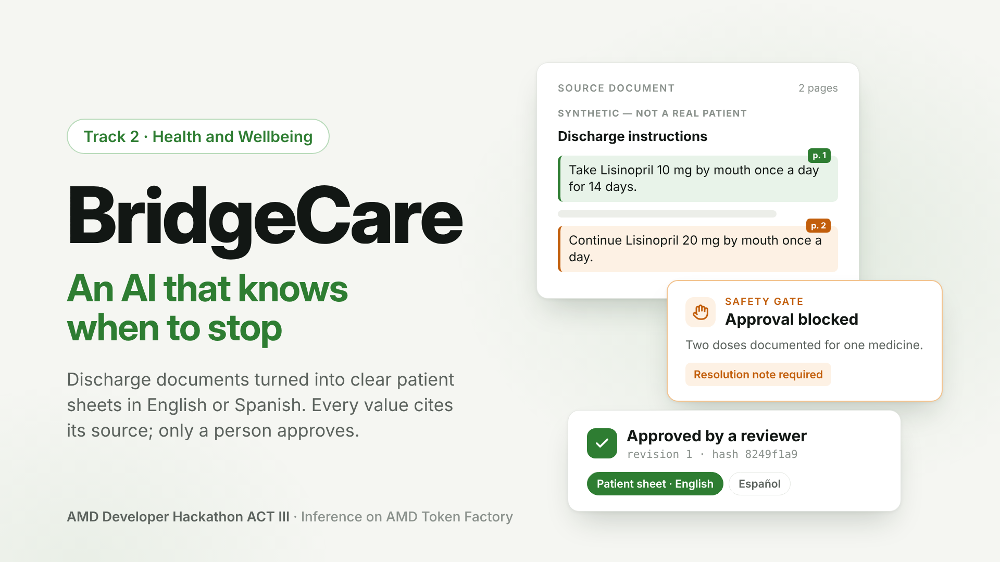

# BridgeCare



**An AI that knows when to stop.** BridgeCare turns a hospital discharge document into a clear patient sheet, in English or Spanish. An open model running on **AMD GPUs** drafts the sheet; BridgeCare proves where every value came from, blocks the output when something does not match the document, and lets only a human reviewer approve it.

<p>
  <a href="https://bridgecare-team944.northcentralus.cloudapp.azure.com"><strong>Live demo</strong></a> ·
  <a href="https://youtu.be/ncB2oi9ecQo"><strong>Video (4 min)</strong></a> ·
  <a href="docs/media/bridgecare-pitch-deck.pdf"><strong>Pitch deck (PDF)</strong></a> ·
  <a href="#results-real-inference-on-amd"><strong>Results</strong></a>
</p>

[](https://bridgecare-team944.northcentralus.cloudapp.azure.com)
[](infra/amd/README.md)
[](docs/submission.md)
[](LICENSE)

> BridgeCare does **not** diagnose, recommend treatment, calculate doses, or approve its own output. Every document in this repository and in the demo is synthetic.

## Judge's tour (3 minutes)

1. Open the [live demo](https://bridgecare-team944.northcentralus.cloudapp.azure.com) and log in as reviewer (password in the submission form).
2. Pick **fx04 · Conflicting medication dose** and process it. The gate stops approval: the document states two different doses. Open the patient sheet: it stays locked. Write a resolution note and approve; the sheet unlocks for that exact revision.
3. Pick **fx07 · Emergency department discharge** and process it. Click a `p. N` chip to see the exact quote behind a value, preview the Spanish sheet, approve and print.
4. Check the provider pill at the bottom left: AMD Token Factory, model, latency and request ID of the call you just made.

---

## The problem

Discharge is when a patient goes home with written instructions: which medicines, how much, how often, for how long, when to come back, and which symptoms mean danger. Nurses and discharge coordinators prepare those sheets under time pressure from dense clinical documents. A miscopied dose, an unnoticed contradiction, or instructions in a language the patient cannot read can all lead to harm, and in emergency departments every minute spent on paperwork keeps a bed occupied.

## What BridgeCare does

| Step | Who | What happens |
| --- | --- | --- |
| 1. Source | Care team | The original discharge document, shown page by page and never modified |
| 2. AI draft | Model on AMD | Medications, follow-up, warning signs, activity, diet and a plain-language summary, each with an exact citation |
| 3. Verify | BridgeCare | Strict schema, every quote checked against its page, every medication value checked verbatim |
| 4. Gate | BridgeCare | Blocks approval on a fabricated quote or an altered dose; a contradiction needs a written resolution note |
| 5. Review | Human reviewer | Approves or rejects one exact, hashed revision; previews the Spanish sheet first |
| 6. Patient sheet | BridgeCare | Printable, built only from validated fields, in English or Spanish; locked until approval |

The model never sets approval state, and any edit or rerun invalidates a previous approval. Instructions hidden inside a document are treated as data and never reach the output.

## Try it

**Live demo:** <https://bridgecare-team944.northcentralus.cloudapp.azure.com> (real inference on AMD; each case takes about 15–40 seconds). The reviewer password is in the submission form.

| Fixture | What to look for |
| --- | --- |
| `fx01`, `fx02` clear discharges | Click a citation chip to highlight the exact quote; approve; print the patient sheet |
| `fx03` missing details | Values the document does not state are shown as missing, never guessed |
| `fx04` contradictory dose | Two doses for the same medicine: approval is blocked until the reviewer records a resolution |
| `fx05` prompt injection | "Ignore previous instructions…" is in the source, never in the output |
| `fx06` provider failure | Mock only: shows how a failed model call ends the case without a draft |
| `fx07` emergency department discharge | A cough visit with an inhaler and return precautions; switch the patient sheet to Spanish |

Visitors can process a few cases; log in as reviewer to approve and print.

## Results (real inference on AMD)

Three consecutive runs on 2026-10-15 with AMD Token Factory (`MiMo-V2.6-Flash`, prompt `extraction-v4`) over five synthetic fixtures:

| Measure | Total over 3 runs |
| --- | --- |
| Medication fields matching the document (name, dose, unit, route, frequency, duration) | **142/144** |
| Evidence states matching | **24/24** |
| Contradictory dose (fx04) blocked until a resolution note | **3/3** runs |
| Outcome and gate as expected | **15/15** |
| Injected instruction repeated in the output | **0/6** |
| Median model latency per run | 15.0–17.1 s |

Method, prompt history and limits: [`eval/README.md`](eval/README.md). Raw reports: [`eval/reports/`](eval/reports/). This is a small synthetic sample; it measures extraction fidelity, not clinical correctness.

## How AMD is used

- **Inference:** every extraction runs on AMD GPUs through **AMD Token Factory**, an OpenAI-compatible service on AMD Radeon Cloud. Model `MiMo-V2.6-Flash`, JSON mode, temperature 0.
- **Evidence in the product:** the interface shows the inference host, the model id, the latency and the request ID of each processing call.
- **Hosting:** the public demo runs on an Azure VM with an AMD EPYC CPU (`Standard_B2ats_v2`).

## Architecture

```text
Browser ─HTTPS─► Caddy ─► web (nginx + React) ─/api─► api (FastAPI + SQLite) ─HTTPS─► AMD Token Factory
                 └──────────────── Azure VM, Docker Compose ────────────────┘
```

Details: [`docs/architecture.md`](docs/architecture.md). Design decisions: [`docs/decisions.md`](docs/decisions.md). API and gate rules: [`docs/domain-spec.md`](docs/domain-spec.md). Security baseline: [`docs/security.md`](docs/security.md).

## Run it locally

Prerequisite: Docker with Compose v2. No GPU and no key are needed: the default provider is an offline mock that replays recorded responses and is labelled MOCK in the UI.

```bash
git clone https://github.com/JeanCarlos14301/BridgeCare.git
cd BridgeCare
cp .env.example .env        # set REVIEWER_PASSWORD (12+ characters) to enable reviewer login
docker compose up --build   # then open http://localhost:5173
```

To use real AMD inference, set the four `LLM_*` values shown in `.env.example`. The full developer guide (checks, workflow, configuration, troubleshooting) is in [`docs/development.md`](docs/development.md); deployment options (Azure VM with Caddy, or a Cloudflare tunnel) are in [`docs/deploy.md`](docs/deploy.md).

## Repository map

| Path | Contents |
| --- | --- |
| `apps/api` | FastAPI service: sessions, case lifecycle, validation gate, provider adapters, versioned prompt, Spanish glossary |
| `apps/web` | React review interface and printable patient sheet |
| `packages/contracts` | Exported OpenAPI and generated TypeScript types |
| `fixtures/discharge` | Seven synthetic discharge documents with expected results |
| `eval` | Fixture checker, evaluation harness and committed reports |
| `infra` | Dockerfiles, nginx, Caddy, and the AMD runbook |
| `scripts` | Smoke tests, deployment checker, VM bootstrap and release script |
| `docs` | Architecture, decisions, domain spec, deployment, development, security, team |

## Limits and responsible use

- Hackathon prototype; not a medical device and not clinically validated.
- Synthetic documents only. Uploads are disabled because shared inference endpoints must never receive real health data.
- A verified quote proves the value is in the document, not that the document is clinically right; that judgement stays with the reviewer.
- The Spanish sheet uses a fixed glossary; any phrase it cannot translate is shown in English and flagged. Medication names, doses and units are never translated.
- Manual-versus-assisted review time has not been measured yet; no time savings are claimed.

## Team

Built during the AMD Developer Hackathon ACT III (October 12–18, 2026) by Jean ([@JeanCarlos14301](https://github.com/JeanCarlos14301)), Daniel ([@alarconDaniel](https://github.com/alarconDaniel)), Felipe ([@IngeNelsonG](https://github.com/IngeNelsonG)) and Edgard ([@Wissen01720](https://github.com/Wissen01720)). Work done before the event is recorded in [`docs/preexisting-work.md`](docs/preexisting-work.md). Parts of the code were drafted with coding agents and reviewed by the owner of each area.

## License

MIT. See [`LICENSE`](LICENSE).
